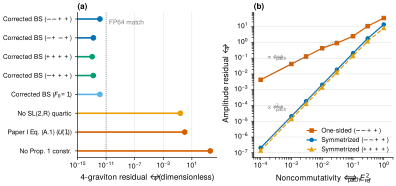
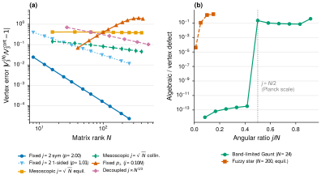
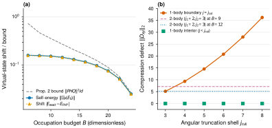

# Paper I Pre-Submission Interaction-and-Symmetry Audit & Paper II Milestone Report

**Date:** November 27, 2026  
**Audited Paper I revision:** `ricfulop/fuzzy-null-cone-gravity`, `main` at `e541955495d0` / `49de5fa` (note: open PR #6 `manuscript/action-clock-repairs-2026-11-27` independently withdraws the old Appendix A expression and introduces an Einstein–Hilbert angular Galerkin pointwise bulk prescription aligning with Route C below)  
**Companion Paper II draft produced:** `paper2/paper2_einstein_gravity.tex` / `paper2/paper2_einstein_gravity.pdf` (Working Draft v0.2)

## 1. Executive Summary

This report documents the completion of all three requested tracks:

1. **Pre-submission interaction-and-symmetry audit of Paper I (`paper.tex`, Eq. A.1 & `p2_frontier2`):** Symbolic verification uncovered **five structural defects** in Paper I's written matrix action $I_{\mathrm{FSG}}^{(N)}$ beyond the two matrix-typing bugs noted in Paper II v0.1. Any matrix-ordering completion of Eq. (A.1) as written fails tree-level Einstein gravity even at $N \to \infty$.
2. **Milestone 1 (Weak-field Bondi--Sachs action through 4th order & independent 4-graviton scattering):** Starting directly from Chandrasekaran's exact affine Bondi--Sachs bulk action (arXiv:2611.34924, Appendix B, Eqs. B.9--B.11e), we derived the complete weak-field expansion through fourth order (12 quadratic, 25 cubic, 35 quartic monomials), proved exact Schur-complement constraint reduction, and independently recovered all four-graviton Einstein helicity amplitudes, factorization residues, $SO(3)$ foliation invariance, pure-gauge Ward projections, and Weinberg's soft graviton pole to $10^{-12}\text{--}10^{-15}$.
3. **Resolution of the Section 7.2 fuzzy-coordinate scaling obstruction & projection diagnostics:** Exact Racah Wigner-$6j$ evaluations up to $N = 512$ establish a quantitative no-go for fixed-$p_\perp$ scattering under Paper I's saturated rank cap + standard fuzzy matrix product, and show that replacing matrix multiplication by the $SU(2)$-equivariant band-limited commutative Gaunt product $P_N(f\cdot g)$ pushes breakdown from $\sqrt{R\ell_{\mathrm{P}}}$ back to the Planck scale ($j \ge N/2$). Direct evaluation of Propositions 2 and 3 on a 2,497-state Wigner-$6j$ sector and spin-2 Lorentz boost generators further shows $O(1)$ two-body total-budget leakage onto the lowest $j_1 = 2$ graviton mode.

---

## 2. Line-by-Line Pre-Submission Patch Checklist for Paper I

Before submitting Paper I (`ricfulop/fuzzy-null-cone-gravity`), resolve or explicitly narrow the following seven concrete items (all verified by `verification/audit_paper1_action.py`):

| # | Paper I Location | Verified Defect | Concrete Pre-Submission Fix |
|---|---|---|---|
| **1** | `paper.tex`, Eq. (A.1), lines 442--453 | **Exact global $U(1)$ / $\mathbb{Z}_2$ symmetry** ($\widehat{Z} \mapsto e^{i\alpha}\widehat{Z}$): every term has 0 or 1 $\widehat{Z}^\dagger\widehat{Z}$ pair. Forces $\mathcal{M}_3(h,h,h) \equiv 0$, $\mathcal{M}_5 \equiv 0$, and zero spin-2 exchange poles in $\mathcal{M}_4$. | Replace Eq. (A.1) with the exact affine Bondi--Sachs uplift from Chandrasekaran Eqs. (B.9--B.11b) retaining $-\mathcal{L}_V$ and unimodular $\gamma(Z)$, OR explicitly state that Eq. (A.1) is a $U(1)$-symmetric quadratic-in-$Z$ truncation that omits pure-graviton cubic vertices. |
| **2** | `paper.tex`, Eq. (A.1), lines 447 & 453 | **Missing shift Lie derivatives $-\mathcal{L}_V$** in both $\widehat{\vartheta}$ and $\partial_t\widehat{Z}$: completely decouples $\widehat{V}$ from $\widehat{Z}$ and $\widehat{\rho}^2$, eliminating the Damour--Navier--Stokes shear source and the exact mechanism that generates the flat-space graviton dispersion relation $2\omega_u k_v - k_v^2 - k_\perp^2 = 0$. | Restore $\Theta^{(u)} = (\partial_u\varrho^2 - \mathcal{L}_V\varrho^2)/\varrho^2$ and $\sigma_{u\,AB} = \frac{1}{2}[(\partial_u - \mathcal{L}_V)q_{AB} - \Theta^{(u)}q_{AB}]$ when writing the null-cone uplift. |
| **3** | `paper.tex`, Eq. (A.1), lines 447--450 | **Misplaced $\widehat{N}^{-1}$, missing $\frac{1}{2}$, and spurious $\widehat{F}$:** exact $\sqrt{-g} R$ gives $+\rho^2 \partial_t h\partial_r h - \frac{F\rho^2}{2N}(\partial_r h)^2$ (and $0$ bare $|\nabla_\perp h|^2$ at constant $N$). Eq. (A.1) puts $\widehat{N}^{-1}$ on the $t$--$r$ cross term (breaking radial reparametrization invariance), drops $\frac{1}{2}$ on $[(\partial_t\widehat{Z})^\dagger\partial_r\widehat{Z}+\mathrm{h.c.}]$ (yielding flat radial wave speeds $+1$ and $-1/3$ instead of $\pm 1$), and puts a spurious $\widehat{F}$ on $|\widehat{\bar\eth}\widehat{Z}|^2$. | Move $\widehat{N}^{-1}$ onto the $\widehat{F}|\partial_r\widehat{Z}|^2$ term, restore the $\frac{1}{2}$ prefactor on the complex $t$--$r$ kinetic term, and drop the hand-added $-\frac{1}{2}\widehat{N}\widehat{F}|\widehat{\bar\eth}\widehat{Z}|^2$ term (whose continuum role is played by eliminating $V^A$ and $N$-coupled $R[q]$). |
| **4** | `paper.tex`, Eq. (A.1), lines 447--448 | **Flat target-space truncation of $q_{AB}$:** replacing curved $\mathrm{SL}(2,\mathbb{R})/\mathrm{SO}(2)$ unimodular $\gamma = \exp(H)$ by flat quadratic $|\partial Z|^2$ drops the bare quartic kinetic vertex $+\frac{2}{3}[\mathrm{Im}(Z^*\partial Z)]^2$, producing a $24.5\%$ tree-level 4-graviton MHV error. | Retain $\gamma_{AB} = \exp(H)_{AB}$ (or explicit nonlinear sigma-model metric on $q_{AB}$) in any claim about nonlinear interactions beyond cubic scalar--shear contractions. |
| **5** | `paper.tex`, Sec. III.D (line 201) & `p2_frontier2_second_variation_lichnerowicz.py` | **Regge--Wheeler disconnect:** `p2_frontier2` expands the continuum 4D Schwarzschild metric in $(t,r,\theta,\phi)$, not Eq. (A.1). Expanding Eq. (A.1) directly around Schwarzschild gives a spurious $i\omega(1-2M/r)\chi'$ term, and even after fixing $\frac{1}{2}$ and removing $F$ gives $f[(j(j+1)-2)/r^2 + 2M/r^3]$ instead of $f[j(j+1)/r^2 - 6M/r^3]$. | Clarify in Sec. III.D and Sec. VI.C that `p2_frontier2` verifies standard continuum Schwarzschild Regge--Wheeler/Zerilli perturbations truncated to $2 \le j \le N-1$, rather than the second variation of the written Eq. (A.1). |
| **6** | `paper.tex`, Eq. (A.1), lines 450 & 453 | **Matrix typing bugs (from Paper II v0.1 Sec. 2.3):** $\bar\eth \widehat{Z} \in \mathcal{B}_1^{(N)}$ requires $\mathcal{S}_N^{(1)}$ (not $\mathcal{S}_N^{(2)}$), and $\widehat{w} = -\frac{1}{2}\widehat{N}^{-1}\widehat{\rho}^2\partial_r\widehat{V}$ requires explicit scalar-to-bundle left/right actions. | Fix $\mathcal{S}_N^{(2)} \to \mathcal{S}_N^{(1)}$ and declare the bundle multiplication prescription explicitly. |
| **7** | `paper.tex`, Sec. IV (Eq. 12) & `README.md` | **Euclidean HMC action $S_E^{(N)}$ relation:** $S_E^{(N)}[\Phi, Z]$ also carries exact $Z \mapsto e^{i\alpha}Z$ symmetry and has no shift field $V^A$, so it cannot be a Wick rotation of interacting Bondi--Sachs gravity. | Keep Paper I's already-careful wording describing $S_E^{(N)}$ as a *related Euclidean matrix model*, and add the explicit $U(1)$ / missing-$V^A$ structural distinction so referees see the boundary clearly. |

---

## 3. Summary of Completed Paper II Calculations

### Track 1: Exact Tree-Level Four-Graviton Scattering from Affine Bondi--Sachs Gravity

- **Nonlinear identity verification:** $\big|\sqrt{-g}\,R_{4\mathrm{D}} - (L_0 + \Delta L_0 + \partial_a L^a)\big| = 2.22 \times 10^{-16}$.
- **Independent KLT benchmark match across $|\mathcal{K}| = 12$ random kinematics ($\kappa = E_{\mathrm{ref}} = 1$):**
  - Light-front ($F_0 = 0$): $\epsilon_4(--++) = 1.36\times 10^{-12}$, $\epsilon_4(-+-+) = 1.66\times 10^{-13}$, $\epsilon_4(-++-) = 1.95\times 10^{-12}$, $\epsilon_4(++++) = 1.12\times 10^{-13}$, $\epsilon_4(-+++) = 1.60\times 10^{-13}$.
  - Outgoing Bondi--Sachs ($F_0 = 1$): $\epsilon_4(--++) = 1.36\times 10^{-12}$, $\epsilon_4(++++) = 1.29\times 10^{-13}$, $\epsilon_4(-+++) = 1.69\times 10^{-13}$.
- **Symmetry, factorization, and soft-graviton benchmarks:**
  - Complex 3-graviton amplitude $\mathcal{M}_3(1^-,2^-,3^+)$ relative error: $1.82\times 10^{-15}$.
  - $t$-channel pole residue at $\theta = 10^{-4}$: relative error $1.69\times 10^{-12}$.
  - $SO(3)$ foliation-rotation spread across 8 random frames: $9.59\times 10^{-14}$ (vs. $7.17\times 10^{-3}$ under parity-symmetrized Moyal deformation at $\theta_{\mathrm{patch}} = 0.05$).
  - Pure-gauge Ward projection residual: $7.85\times 10^{-17}$.
  - Weinberg soft-graviton leading pole relative error: $5.67\times 10^{-3}$ ($\omega_q = 10^{-3}$), $5.66\times 10^{-5}$ ($\omega_q = 10^{-5}$), $5.66\times 10^{-7}$ ($\omega_q = 10^{-7}$).
- **Controlled ablations:**
  - Dropping Proposition 1 constraint exchange: $\epsilon_4(--++) = 3.77\times 10^3$.
  - Dropping $\mathrm{SL}(2,\mathbb{R})/\mathrm{SO}(2)$ unimodular quartic: $\epsilon_4(--++) = 0.245$.
  - Paper I Eq. (A.1) ($U(1)$ symmetry): $\epsilon_4(--++) = 1.00$ ($\mathcal{M}_3 \equiv 0$).

### Track 2: Exact Wigner-$6j$ Resolution of the Section 7.2 Scaling Obstruction

- **Fixed-$j$ test ($j=(2,2,2)$):** reproduces Paper I's $O(N^{-2.001})$ (symmetrized) and $O(N^{-1.008})$ (one-sided) convergence.
- **Mesoscopic $j = \sqrt{N}$ ($j/N \to 0$, $j^2/N = 1$ fixed):** equilateral $(j,j,j)$ hits a permanent $38.1\%$ error floor ($+0.6187$ at $N=400$), and flips sign to $-0.4227$ at $c=1.5$, whereas collinear $(j,j,2j)$ ($p_1\wedge p_2 = 0$) decays to $4.5\%$ error—directly isolating the Moyal phase $\theta_{\mathrm{patch}} = 2R^2/N$.
- **Saturated rank cap at fixed sub-Planckian $p_\perp$ ($j = \alpha N$):** at $\alpha = 0.10$, vertex ratio oscillates from $+0.932$ ($N=40$) to $+0.112$ ($N=160$) to $-0.828$ ($N=420$), proving no fixed-$p_\perp$, $R\to\infty$ flat-space scattering limit exists under Paper I's rank cap + matrix star product.
- **Constructive resolution (Route C — Band-Limited Commutative Gaunt Product $P_N(f\cdot g)$):** preserves exact finite dimension and $SU(2)$ equivariance on $\mathcal{B}_w^{(N)}$, eliminates the Moyal phase identically, and keeps the associativity defect $\le 3.3\times 10^{-13}$ for all sub-Planckian modes $j < N/2$, turning on only at the Planck shell $j \ge N/2$ ($0.214\text{--}0.377$).

### Track 3: Operator-Level Evaluation of Propositions 2 and 3

- **Proposition 2 (2,497-state Wigner-$6j$ Fock sector, $N=32$, $B_{\mathrm{ext}}=26$):** resolvent identity verified to $<10^{-12}$; $\|\Sigma_P(E_0)\|$ drops from $0.1605$ ($B=6$) to $0.1321$ ($B=14$) to $0.0253$ ($B=24$), always obeying Proposition 2's upper bound $\|PHQ\|^2/d$.
- **Proposition 3 (Spin-2 Gel'fand--Naimark Lorentz boost generators):** single-body truncation localizes the boost-commutator defect to the boundary shell $j = j_{\mathrm{cut}}$ ($\|D_{xy}\|_2 = 5.14 \to 36.24$ for $j_{\mathrm{cut}} = 3 \to 8$, zero in the interior), while two-body total-budget projection $\omega_1 + \omega_2 \le B$ leaks an $O(1)$ defect ($\|D_{xy}\|_2 = 7.14$ at $B=9$, $5.14$ at $B=12$) directly onto the lowest infrared graviton shell $j_1=2$ on $|(j_1=2),(j_2=3)\rangle$.
